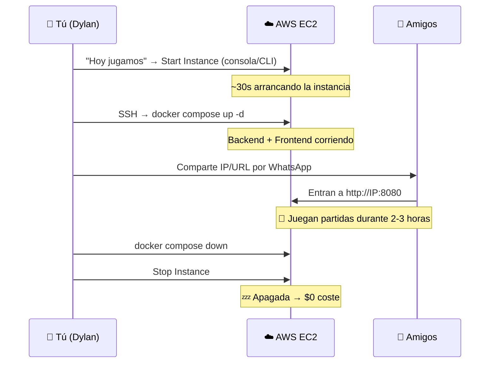
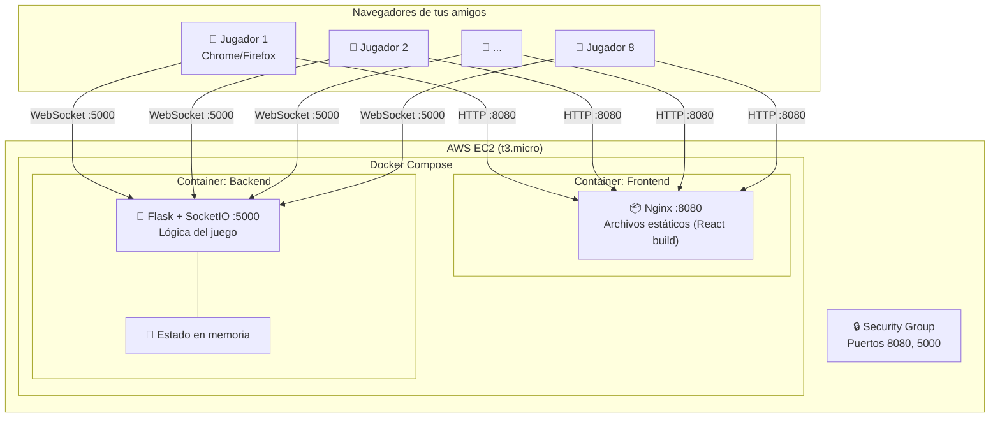

# 🐺 Despliegue Online — One Night Werewolf DDD

## Resumen de la Situación Actual

Tu proyecto está bien estructurado para desplegarse online. Aquí un resumen de lo que tienes:

| Componente | Tecnología | Estado |
|---|---|---|
| **Backend** | Flask + Flask-SocketIO + Eventlet | ✅ Funcional con WebSockets |
| **Frontend** | React 18 + Vite + TailwindCSS + Zustand | ✅ SPA lista para build |
| **Comunicación** | Socket.IO (WebSocket + polling fallback) | ✅ Tiempo real |
| **Estado** | En memoria (`RoomRepository` con `Dict`) | ⚠️ Suficiente para tu uso |
| **Docker** | docker-compose con 2 servicios (backend + nginx) | ✅ Listo |
| **Var. Entorno** | `VITE_SOCKET_URL` configurable | ✅ Parametrizado |

### Requisitos Técnicos Clave para el Despliegue

1. **WebSockets obligatorios**: Socket.IO necesita soporte de WebSocket persistente (no solo HTTP)
2. **Un solo proceso backend**: El estado está en memoria — no se puede tener múltiples instancias del backend
3. **Baja carga**: 7-8 usuarios simultáneos es trivial para cualquier servidor
4. **Sin base de datos**: No hay persistencia externa necesaria
5. **Uso esporádico**: Solo necesita estar activo cuando quedéis para jugar (tú lo enciendes manualmente)

---

## Opciones de Despliegue en AWS

Ya que usas AWS en el trabajo y la idea es activarlo solo cuando juguéis, hay 3 opciones AWS que encajan. Las ordeno de más simple a más compleja.

---

### Opción A — EC2 con Docker (⭐ RECOMENDADA)

La opción más directa: una instancia EC2 donde levantas tu `docker-compose.yml` tal cual. Tú la enciendes/apagas desde la consola de AWS o con un comando CLI.

| Aspecto | Detalle |
|---|---|
| **Servicio** | EC2 (`t3.micro` o `t4g.micro`) |
| **Soporte WebSocket** | ✅ Nativo (es tu servidor, no hay restricciones) |
| **Docker** | ✅ Instalas Docker una vez y usas tu `docker-compose.yml` existente |
| **Precio** | `t3.micro`: ~$0.0104/hora → **~$0.05 por sesión de 5 horas**. Si tienes Free Tier activo: **$0 los primeros 12 meses** (750 hrs/mes de t2.micro/t3.micro) |
| **Deploy** | SSH → `docker compose up -d` (o un script de un solo comando) |
| **Dominio** | IP pública elástica (Elastic IP) gratis mientras la instancia esté activa |
| **HTTPS** | Opcional con Let's Encrypt, o sin HTTPS usando HTTP puro (para uso privado entre amigos, es aceptable) |
| **Encendido/Apagado** | Consola AWS, CLI (`aws ec2 start-instances`), o incluso un bot de Discord/Telegram |

**¿Por qué es la mejor opción para ti?**

1. **Ya conoces AWS** — no hay curva de aprendizaje de plataforma nueva
2. **Docker compose directo** — tu `docker-compose.yml` funciona tal cual, sin adaptaciones
3. **Control total de encendido/apagado** — pagas solo las horas que juegues (~céntimos)
4. **Sin limitaciones de WebSocket** — es tu servidor, no hay proxies intermedios que compliquen
5. **Setup una sola vez** — instalas Docker, clonas el repo, y a partir de ahí solo es `start`/`stop`

#### Flujo de uso típico

#### Coste estimado

| Concepto | Coste |
|---|---|
| Instancia `t3.micro` (2 vCPU, 1GB RAM) | $0.0104/hora |
| Elastic IP (mientras la instancia está activa) | $0 |
| Elastic IP (mientras la instancia está **apagada**) | $0.005/hora (~$3.6/mes si la dejas apagada siempre) |
| **Sesión de juego de 4 horas** | **~$0.04** |
| **Jugar 4 veces al mes** | **~$0.17** |

> [!TIP]
> **Truco para ahorrar**: En vez de usar Elastic IP (que cobra cuando la instancia está parada), puedes simplemente anotar la IP pública nueva cada vez que enciendas la instancia. Cambia cada vez, pero solo tienes que copiarla y pegarla en el grupo de WhatsApp. Coste: **$0 real**.

> [!NOTE]
> **Free Tier**: Si tu cuenta de AWS tiene menos de 12 meses, tienes 750 horas/mes gratis de `t2.micro` o `t3.micro`. Eso es más que suficiente.

---

### Opción B — AWS Lightsail

La versión "simplificada" de EC2 para gente que no quiere lidiar con VPCs, Security Groups, etc. Precio plano.

| Aspecto | Detalle |
|---|---|
| **Servicio** | Lightsail (instancia con Docker) |
| **Soporte WebSocket** | ✅ Nativo |
| **Docker** | ✅ Blueprint con Docker preinstalado |
| **Precio** | Plan más barato: **$3.50/mes fijo** (512MB RAM, 1 vCPU). Incluye IP estática y 1TB de transferencia |
| **Deploy** | Similar a EC2 pero con interfaz más simple |
| **HTTPS** | Integrado con Let's Encrypt de forma guiada |
| **Complejidad** | 🟢 Más simple que EC2 |

> [!WARNING]
> **Desventaja vs EC2**: El precio es plano — pagas $3.50/mes aunque no juegues. No puedes "apagar y dejar de pagar" como con EC2. Para tu uso esporádico, EC2 es más económico.

---

### Opción C — ECS Fargate (Contenedores Serverless)

Correr tus contenedores Docker sin gestionar servidor. AWS se encarga de la infraestructura.

| Aspecto | Detalle |
|---|---|
| **Servicio** | ECS Fargate + ALB (Application Load Balancer) |
| **Soporte WebSocket** | ✅ ALB soporta WebSocket con sticky sessions |
| **Docker** | ✅ Usa tus Dockerfiles directamente (push a ECR) |
| **Precio** | Fargate: ~$0.04/hora (0.25 vCPU, 0.5GB). **PERO** ALB: ~$16/mes fijo (mínimo). Total: **~$16-18/mes** |
| **Deploy** | Push imagen a ECR → actualizar servicio ECS |
| **HTTPS** | ✅ ACM (certificado gratis) + ALB |
| **Complejidad** | 🔴 Alta — Task Definitions, Services, ALB, Target Groups, ECR... |

> [!CAUTION]
> **Overengineered para tu caso**. ECS Fargate es genial para producción empresarial, pero para 8 amigos jugando de vez en cuando es matar moscas a cañonazos. El ALB solo ya cuesta ~$16/mes. No lo recomiendo salvo que quieras practicar ECS específicamente.

---

## Comparativa de Opciones

| Criterio | EC2 + Docker ⭐ | Lightsail | ECS Fargate | Railway | Render (Free) |
|---|---|---|---|---|---|
| **Coste (uso esporádico)** | ~$0/mes | $3.50/mes | ~$16/mes | ~$0-5/mes | $0 |
| **Tiempo de setup** | ~1 hora | ~45 min | ~3 horas | ~30 min | ~30 min |
| **WebSockets** | ✅ | ✅ | ✅ (con ALB) | ✅ | ✅ |
| **Encender/apagar** | ✅ Fácil | ⚠️ Posible pero pago fijo | ⚠️ Complejo | ✅ | ❌ Auto-sleep |
| **Docker Compose** | ✅ Directo | ✅ Directo | ❌ Adaptación | ✅ | ❌ Solo Dockerfile |
| **HTTPS** | ⚠️ Manual | ✅ Guiado | ✅ Auto | ✅ Auto | ✅ Auto |
| **Conocimiento previo** | ✅ Ya usas AWS | ✅ AWS simplificado | ✅ AWS avanzado | ❌ Nueva plataforma | ❌ Nueva plataforma |
| **Ideal para** | **Tu caso exacto** | Si prefieres precio fijo | Si quieres practicar ECS | Si quieres zero-config | Si quieres $0 absoluto |

---

## Diseño de Arquitectura (EC2 Recomendado)

> [!NOTE]
> **¿Sin HTTPS?** — Para un juego privado entre amigos, HTTP funciona perfectamente. No manejas datos sensibles (contraseñas, pagos). Si en el futuro quieres HTTPS, se puede añadir Let's Encrypt con un `docker-compose` adicional de Certbot.

---

## Cambios Necesarios en el Código

> [!IMPORTANT]
> Son cambios menores. No afectan la funcionalidad del juego.

### 1. Variables de entorno de producción

| Archivo | Cambio |
|---|---|
| [app.py](file:///c:/Users/dylan/OneDrive/Escritorio/Proyecto%20web/werewolf_DDD/backend/main/app.py) | Sacar `SECRET_KEY` a variable de entorno |
| [run.py](file:///c:/Users/dylan/OneDrive/Escritorio/Proyecto%20web/werewolf_DDD/backend/run.py) | Usar `debug=False` y leer puerto de `$PORT` |
| [constants.js](file:///c:/Users/dylan/OneDrive/Escritorio/Proyecto%20web/werewolf_DDD/frontend/src/utils/constants.js) | Ya está parametrizado con `VITE_SOCKET_URL` ✅ |

### 2. Docker Compose para producción

| Archivo | Cambio |
|---|---|
| [docker-compose.yml](file:///c:/Users/dylan/OneDrive/Escritorio/Proyecto%20web/werewolf_DDD/docker-compose.yml) | Actualizar `VITE_SOCKET_URL` para apuntar a `http://<IP_PUBLICA>:5000` |
| [nginx.conf](file:///c:/Users/dylan/OneDrive/Escritorio/Proyecto%20web/werewolf_DDD/frontend/nginx.conf) | Opcionalmente añadir proxy reverso WebSocket (para usar un solo puerto) |

### 3. Seguridad básica

| Cambio | Motivo |
|---|---|
| Generar `SECRET_KEY` aleatorio | El actual es `'your-secret-key-here'` (placeholder) |
| Opcionalmente restringir CORS | Actualmente es `cors_allowed_origins="*"`, aceptable para uso privado |
| Desactivar endpoints de test/debug | Los endpoints `/test/*` y `/debug/*` no deberían estar accesibles |

### 4. Security Group en EC2

Abrir solo los puertos necesarios:

| Puerto | Protocolo | Origen | Uso |
|---|---|---|---|
| 22 | TCP | Tu IP | SSH para administración |
| 8080 | TCP | 0.0.0.0/0 | Frontend (Nginx) |
| 5000 | TCP | 0.0.0.0/0 | Backend WebSocket |

---

## Pasos Ordenados de Implementación (para EC2)

### Fase 1 — Preparar el código para producción
1. Mover `SECRET_KEY` a variable de entorno
2. Configurar `debug=False` para producción
3. Crear un `docker-compose.prod.yml` (o parametrizar el existente con variables de entorno)
4. Opcionalmente: desactivar endpoints de debug/test con un flag de entorno

### Fase 2 — Preparar la instancia EC2
5. Lanzar instancia `t3.micro` (Amazon Linux 2023 o Ubuntu 22.04)
6. Configurar Security Group (puertos 22, 8080, 5000)
7. Instalar Docker y Docker Compose en la instancia
8. Clonar tu repo desde GitHub

### Fase 3 — Primer despliegue
9. Configurar variables de entorno (`VITE_SOCKET_URL=http://<IP>:5000`)
10. Ejecutar `docker compose up -d --build`
11. Verificar que frontend carga en `http://<IP>:8080`
12. Verificar que WebSocket conecta correctamente

### Fase 4 — Crear rutina de encendido/apagado
13. Documentar o crear script: `aws ec2 start-instances --instance-ids i-xxx`
14. Documentar o crear script: `aws ec2 stop-instances --instance-ids i-xxx`
15. Opcionalmente: crear un alias/script que encienda + espere + muestre la IP

### Fase 5 — Probar con amigos
16. Encender la instancia
17. Compartir la IP por WhatsApp/Discord
18. Jugar una partida completa de prueba
19. Apagar al terminar

---

## Open Questions

> [!IMPORTANT]
> **¿Confirmas EC2 como plataforma?** — Es la que mejor encaja con tu contexto (ya usas AWS, uso esporádico, coste casi $0). Si prefieres otra opción, dime cuál.

> [!IMPORTANT]
> **¿Tienes el repo en GitHub?** — Vi que tienes `.git`. ¿El repo ya está subido? Lo necesitaremos para clonar en EC2.

> [!NOTE]
> **¿Free Tier activo?** — ¿Tu cuenta AWS tiene menos de 12 meses? Si es así, tienes 750 hrs/mes gratis de `t3.micro`, lo cual hace esto completamente gratis.

> [!NOTE]
> **¿Quieres un solo puerto?** — Actualmente el frontend va por `:8080` y el backend por `:5000`. Podemos configurar Nginx como proxy reverso para que todo vaya por `:80` (un solo puerto, URL más limpia). ¿Te interesa?

> [!NOTE]
> **¿HTTPS?** — Para uso privado entre amigos, HTTP es suficiente. Pero si quieres HTTPS (algunos navegadores pueden quejarse), se puede añadir con Certbot. ¿Te importa o HTTP está bien?
